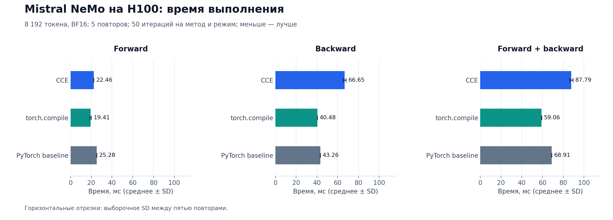
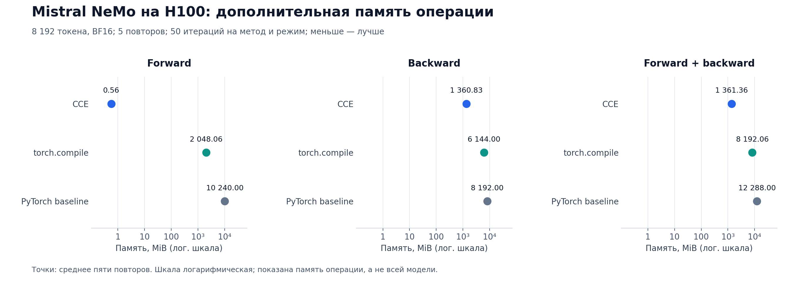
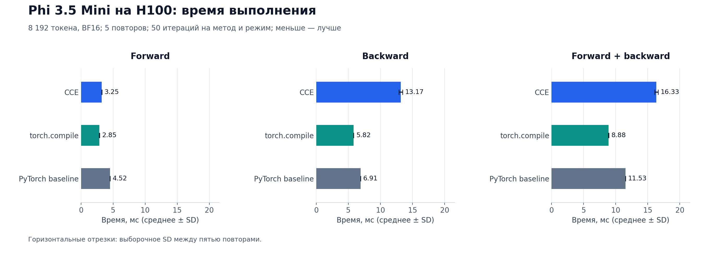
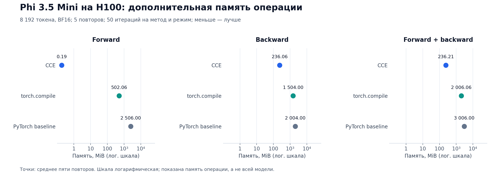

# Воспроизведение Cut Your Losses на H100

Статья: [Cut Your Losses in Large-Vocabulary Language Models](paper.pdf), arXiv:2411.09009v2. [Презентация](slides.pdf) и [её исходный файл](slides.pptx).

Эксперименты выполнены 8 октября 2026 года с [официальным кодом авторов](https://github.com/apple/ml-cross-entropy) на коммите [24fbe4b5dab9a6c250a014573613c1890190536c](https://github.com/apple/ml-cross-entropy/commit/24fbe4b5dab9a6c250a014573613c1890190536c). Исходники CCE и бенчмарков не изменялись. В репозитории находятся команды запуска, исходные CSV, агрегации и графики.

Проверены официальные бенчмарки Mistral NeMo и Phi 3.5 Mini. В обоих случаях CCE использует меньше дополнительной памяти, но при измерении forward + backward работает медленнее `torch.compile` и PyTorch baseline. Полное обучение моделей и остальные эксперименты статьи не воспроизводились.

## Условия

- VM: два NVIDIA H100 80 GB; драйвер 580.126.16.
- Python 3.12.3, PyTorch 2.4.1+cu121, Triton 3.0.0, Transformers 4.48.3, FlashAttention 2.7.0.post2.
- Модели: `mistralai/Mistral-Nemo-Instruct-2407` и `microsoft/Phi-3.5-mini-instruct`; данные: `yahma/alpaca-cleaned`.
- Вход: 8 192 токена, BF16. Методы: `cce`, `torch_compile`, `baseline`. Режимы: forward, backward, forward + backward.
- Для каждого метода и режима штатный бенчмарк авторов выполнял 50 итераций и пять измеряемых повторов после прогрева.
- Входы создаются на GPU1, операция функции потерь и её градиент измеряются на GPU0. Это измерение отдельных операций, а не времени обучения модели.
- Время измерено CUDA events. В таблицах приведены среднее и выборочное стандартное отклонение (SD) по пяти повторам. Память — штатная метрика `op_mem_mb`: прирост пикового выделения PyTorch относительно входов операции. Единица — MiB, поскольку код делит число байт на `2**20`.

## Mistral NeMo

| Режим | Метод | Время, среднее ± SD, мс | Память операции, MiB |
| --- | --- | ---: | ---: |
| Forward | CCE | 22.46 ± 0.03 | 0.56 |
| Forward | torch.compile | 19.41 ± 0.69 | 2048.06 |
| Forward | PyTorch baseline | 25.28 ± 0.07 | 10240.00 |
| Backward | CCE | 66.65 ± 1.52 | 1360.83 |
| Backward | torch.compile | 40.48 ± 0.02 | 6144.00 |
| Backward | PyTorch baseline | 43.26 ± 0.04 | 8192.00 |
| Forward + backward | CCE | 87.79 ± 1.54 | 1361.36 |
| Forward + backward | torch.compile | 59.06 ± 0.09 | 8192.06 |
| Forward + backward | PyTorch baseline | 68.91 ± 0.07 | 12288.00 |

В режиме forward + backward CCE использует в 6.02 раза меньше памяти, чем `torch.compile`, и в 9.03 раза меньше, чем baseline. По времени CCE медленнее соответственно в 1.49 и 1.27 раза.

[Исходные измерения](results/mistral_nemo_h100_5rep.csv) и [агрегация](results/mistral_nemo_summary.csv).

## Phi 3.5 Mini

| Режим | Метод | Время, среднее ± SD, мс | Память операции, MiB |
| --- | --- | ---: | ---: |
| Forward | CCE | 3.25 ± 0.01 | 0.19 |
| Forward | torch.compile | 2.85 ± 0.04 | 502.06 |
| Forward | PyTorch baseline | 4.52 ± 0.00 | 2506.00 |
| Backward | CCE | 13.17 ± 0.28 | 236.06 |
| Backward | torch.compile | 5.82 ± 0.01 | 1504.00 |
| Backward | PyTorch baseline | 6.91 ± 0.00 | 2004.00 |
| Forward + backward | CCE | 16.33 ± 0.26 | 236.21 |
| Forward + backward | torch.compile | 8.88 ± 0.04 | 2006.06 |
| Forward + backward | PyTorch baseline | 11.53 ± 0.01 | 3006.00 |

В режиме forward + backward CCE использует в 8.49 раза меньше памяти, чем `torch.compile`, и в 12.73 раза меньше, чем baseline. По времени CCE медленнее соответственно в 1.84 и 1.42 раза.

[Исходные измерения](results/phi35_h100_5rep.csv) и [агрегация](results/phi35_summary.csv).

На графиках времени показаны среднее и SD. Графики памяти используют логарифмическую шкалу; точки показывают среднее.

## Сравнение со статьёй

Forward + backward, [таблица A3 статьи](https://arxiv.org/html/2411.09009v2):

| Модель | Метод | Статья: A100, мс | Статья: память, MB | Наш H100, мс | Наша память, MiB |
| --- | --- | ---: | ---: | ---: | ---: |
| Mistral NeMo | CCE | 180 | 1362 | 87.79 | 1361.36 |
| Mistral NeMo | torch.compile | 143 | 8192 | 59.06 | 8192.06 |
| Mistral NeMo | baseline | 161 | 12288 | 68.91 | 12288.00 |
| Phi 3.5 Mini | CCE | 34 | 236 | 16.33 | 236.21 |
| Phi 3.5 Mini | torch.compile | 22 | 2006 | 8.88 | 2006.06 |
| Phi 3.5 Mini | baseline | 27 | 3006 | 11.53 | 3006.00 |

Память близка к опубликованным значениям. Абсолютное время напрямую не сопоставимо: в статье использована A100-SXM4 80 GB, у нас H100 и другая программная среда. В таблице A3 CCE для этих двух моделей тоже медленнее сравниваемых методов в режиме forward + backward.

## Как повторить

Команды запускаются из папки `hw2` на Linux x86_64. Требуются Python 3.12, `uv`, `git`, два свободных H100, доступ к PyPI, GitHub и Hugging Face, а также место для моделей. [`requirements-repro.lock`](requirements-repro.lock) фиксирует зависимости. Скрипт установки клонирует официальный репозиторий на указанный коммит и создаёт изолированное окружение.

~~~bash
bash scripts/01_setup.sh
bash scripts/02_tests.sh tests/test_cce_indexed_dot.py tests/test_cce_lse.py
bash scripts/03_phi_benchmark.sh
bash scripts/04_mistral_benchmark.sh

ml-cross-entropy/.venv/bin/python scripts/05_summarize.py results/mistral_nemo_h100_5rep.csv > results/mistral_nemo_summary.csv
ml-cross-entropy/.venv/bin/python scripts/05_summarize.py results/phi35_h100_5rep.csv > results/phi35_summary.csv

uv venv --python python3.12 .plot-venv
uv pip install --python .plot-venv/bin/python -r requirements-plots.txt
.plot-venv/bin/python scripts/06_plot_results.py
.plot-venv/bin/python scripts/06_plot_results.py --input results/phi35_h100_5rep.csv
~~~

Два запуска бенчмарков создают по 45 строк CSV каждый. После установки и обновления зависимости 72 целевых официальных теста прошли за 5.65 с. Полный набор тестов после обновления Transformers не запускался. Без аргументов `02_tests.sh` запускает все официальные тесты.

Версии моделей и датасета, использованные в этих измерениях: Mistral NeMo — `04d8a90549d23fc6bd7f642064003592df51e9b3`, Phi 3.5 Mini — `2fe192450127e6a83f7441aef6e3ca586c338b77`, Alpaca Cleaned — `12567cabf869d7c92e573c7c783905fc160e9639`. Официальный бенчмарк загружает их без явного `revision`, поэтому при повторном скачивании `main` может измениться.

На VM переменная `TRITON_PTXAS_PATH` указывала на CUDA 13.2, несовместимую с Triton 3.0. Скрипты снимают её для процесса, чтобы Triton использовал комплектный `ptxas`. Исходники библиотек для этого не меняются.
